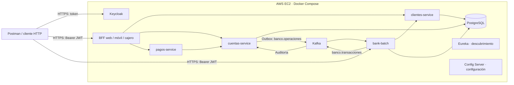

# Banco XYZ — Backend bancario en AWS EC2

Proyecto de backend bancario basado en microservicios y procesamiento por lotes. Permite gestionar clientes y cuentas, realizar depósitos, pagos, transferencias y retiros, y generar reportes diarios, mensuales y anuales.

El entorno de trabajo y ejecución es **una instancia AWS EC2 con Ubuntu y Docker Compose**. Los servicios se construyen y ejecutan dentro de EC2; desde el equipo del usuario se administran por SSH y se prueban con Postman o peticiones HTTPS a la IP pública o al dominio de la instancia.

## Arquitectura

El repositorio contiene diez módulos Maven. Nueve son aplicaciones y `bank-common` es una biblioteca compartida. Docker Compose levanta **12 servicios**, incluyendo PostgreSQL, Kafka y Keycloak.



Las aplicaciones utilizan Config Server para la configuración centralizada y Eureka para el descubrimiento de servicios. Los BFF adaptan las respuestas y operaciones a cada canal. La autenticación utiliza OAuth2/OpenID Connect con Keycloak y la autorización se basa en los roles del JWT.

| Módulo | Responsabilidad |
| --- | --- |
| `bank-common` | DTO, clientes HTTP, propagación del token y componentes compartidos. |
| `clientes-service` | Consulta, creación y actualización de clientes. |
| `cuentas-service` | Gestión de cuentas, saldos, movimientos, cierre y operaciones idempotentes. |
| `pagos-service` | Coordinación de pagos, depósitos y transferencias. |
| `bff-web` | Resumen y gestión de clientes, cuentas y operaciones del canal web. |
| `bff-movil` | Consultas simplificadas, pagos y transferencias del canal móvil. |
| `bff-cajero` | Consulta de saldo y retiros. |
| `bank-batch` | Procesamiento de CSV, control de calidad y reportes bancarios. |
| `config-server` | Configuración por servicio desde `classpath:/config`. |
| `eureka-server` | Registro y descubrimiento de las aplicaciones. |

Tecnologías principales: Java 21, Maven, Spring Boot, Spring Batch, Spring Security, Spring Cloud Config, Eureka, Spring Cloud LoadBalancer, Resilience4j, PostgreSQL 16, Kafka y Keycloak.

## Despliegue y acceso en EC2

La preparación de Ubuntu, instalación de Docker y configuración de la instancia están documentadas en [despliegue.md](despliegue.md). Los pasos siguientes suponen una EC2 preparada, con Docker Engine, el plugin Docker Compose, Git y acceso SSH.

### 1. Conectarse y obtener el proyecto

Desde PowerShell en el equipo del usuario, reemplazar la ruta de la clave y `IP_PUBLICA_EC2`:

```powershell
ssh -i "C:\ruta\banco-xyz.pem" ubuntu@IP_PUBLICA_EC2
```

Dentro de la sesión SSH de EC2:

```bash
git clone https://github.com/ValeriaAcevedoC/Backendlll.git
cd Backendlll
git rev-parse HEAD
```

Si el repositorio ya está en la instancia, entrar en su directorio. Los comandos de Docker de este README se ejecutan desde la raíz del repositorio en EC2.

### 2. Configurar las variables

Crear el archivo de configuración si todavía no existe y editarlo:

```bash
test -f bank-batch/.env || cp bank-batch/.env.example bank-batch/.env
chmod 600 bank-batch/.env
nano bank-batch/.env
```

Completar los valores:

```dotenv
POSTGRES_DB=banco
POSTGRES_USER=banco_app
POSTGRES_PASSWORD=REEMPLAZAR_PASSWORD_BD
KEYCLOAK_ADMIN=administrador
KEYCLOAK_ADMIN_PASSWORD=REEMPLAZAR_PASSWORD_ADMIN
SSL_KEYSTORE_PASSWORD=changeit
PUBLIC_HOST=IP_PUBLICA_EC2
```

`PUBLIC_HOST` debe contener la IP pública o el dominio de EC2, **sin protocolo, puerto ni barras**. Compose configura Keycloak y las siete API con el emisor `https://PUBLIC_HOST:8081/realms/banco`. Si cambia la IP, actualizar esta variable, reaplicar Compose y obtener tokens nuevos.

La contraseña `changeit` corresponde al certificado PKCS12 de demostración incluido. Cambiarla requiere modificar o reemplazar el almacén de claves. Las contraseñas de PostgreSQL y del administrador de Keycloak se eligen para el entorno; conservar `.env` fuera del control de versiones.

### 3. Configurar el Security Group

Para el acceso directo, permitir entrada TCP desde la IP autorizada del operador o del equipo de pruebas:

| Puerto | Uso |
| --- | --- |
| `22` | Administración por SSH. |
| `8081` | Keycloak por HTTPS y obtención de tokens. |
| `8443` | API batch por HTTPS. |
| `8451` | BFF web por HTTPS. |
| `8452` | BFF móvil por HTTPS. |
| `8453` | BFF cajero por HTTPS. |

Los Security Groups controlan el tráfico permitido hacia la instancia; consultar la [documentación de AWS](https://docs.aws.amazon.com/AWSEC2/latest/UserGuide/ec2-security-groups.html). Mantener los puertos de PostgreSQL, Kafka, Config Server, Eureka y los servicios de dominio sin acceso público.

### 4. Construir y levantar los servicios

En EC2, definir este atajo en la terminal actual:

```bash
dc() {
  sudo docker compose --env-file bank-batch/.env -f bank-batch/docker-compose.yml "$@"
}

dc config --quiet
dc up -d --build --wait --wait-timeout 900
dc ps -a
```

Comprobar que los 12 servicios estén saludables. Compose utiliza `healthcheck` y dependencias con `service_healthy` para coordinar el arranque, según el [funcionamiento documentado por Docker](https://docs.docker.com/compose/how-tos/startup-order/).

Las imágenes se construyen con Java y Maven dentro de Docker, por lo que no es necesario instalarlos en el sistema de EC2. La construcción usa `-DskipTests`; ejecutar las pruebas automatizadas por separado.

## Direcciones de los servicios

Reemplazar `IP_PUBLICA_EC2` por la dirección real de la instancia:

| Servicio | Dirección externa | Ruta principal |
| --- | --- | --- |
| Keycloak | `https://IP_PUBLICA_EC2:8081` | `/realms/banco/protocol/openid-connect/token` |
| BFF web | `https://IP_PUBLICA_EC2:8451` | `/api/bff/web` |
| BFF móvil | `https://IP_PUBLICA_EC2:8452` | `/api/bff/movil` |
| BFF cajero | `https://IP_PUBLICA_EC2:8453` | `/api/bff/cajero` |
| Batch | `https://IP_PUBLICA_EC2:8443` | `/api/batch` |

Los servicios internos se consultan desde EC2 o mediante el túnel SSH opcional descrito en [despliegue.md](despliegue.md):

| Servicio | Puerto publicado en EC2 | Protocolo |
| --- | --- | --- |
| Clientes | `8091` | HTTP |
| Cuentas | `8092` | HTTP |
| Pagos | `8093` | HTTP |
| Eureka | `8761` | HTTP |
| Config Server | `8888` | HTTP |
| PostgreSQL | `5433` | PostgreSQL; puerto `5432` dentro del contenedor. |
| Kafka | `9092` | Kafka; las aplicaciones usan `kafka:29092` dentro de Docker. |

Las direcciones `localhost` de los archivos de propiedades son valores de respaldo. En EC2, Compose proporciona las direcciones internas de los contenedores y el emisor público de Keycloak. `localhost` en una sesión SSH se refiere a EC2; en el equipo del usuario requiere un túnel para alcanzar esos servicios.

## Probar las API desde el equipo del usuario

### Postman

Importar [Banco-XYZ-EC2.postman_collection.json](postman/Banco-XYZ-EC2.postman_collection.json) y ajustar la variable `host` a la IP o dominio actual de EC2, sin protocolo ni puerto. La colección contiene una IP preconfigurada que debe comprobarse antes de usarla.

1. Ejecutar las solicitudes de la carpeta **0. Salud (sin token)**.
2. Ejecutar **1. Obtener tokens**. La colección guarda los tokens de cada canal automáticamente.
3. Probar las carpetas de BFF web, móvil y cajero, y después batch.
4. Cambiar `prueba_id` para una nueva ronda de operaciones y mantenerlo al reintentar la misma operación.

El certificado HTTPS incluido es de demostración. Para estas pruebas, Postman requiere desactivar la verificación del certificado; volver a activarla al usar un certificado confiable. Los ejemplos con `curl -k` utilizan la misma excepción.

El realm `banco` incluye estos usuarios de demostración:

| Canal | Usuario | Contraseña de demostración | Rol |
| --- | --- | --- | --- |
| Web y batch | `web` | `web123` | `WEB` |
| Móvil | `movil` | `movil123` | `MOVIL` |
| Cajero | `cajero` | `cajero123` | `CAJERO` |

Estos usuarios provienen de [realm-banco.json](bank-batch/keycloak/realm-banco.json). Las credenciales del administrador se configuran por separado en `.env`.

### Ejemplo con PowerShell

Obtener un token web y consultar el resumen, reemplazando `IP_PUBLICA_EC2`:

```powershell
$ec2Host = "IP_PUBLICA_EC2"
$respuesta = curl.exe -k -f -sS -X POST "https://${ec2Host}:8081/realms/banco/protocol/openid-connect/token" --data-urlencode "client_id=bank-batch-client" --data-urlencode "grant_type=password" --data-urlencode "username=web" --data-urlencode "password=web123" | ConvertFrom-Json
$tokenWeb = $respuesta.access_token
curl.exe -k -f -sS -H "Authorization: Bearer $tokenWeb" "https://${ec2Host}:8451/api/bff/web/resumen"
```

Enviar `Authorization: Bearer <access_token>` en las peticiones protegidas. Una llamada sin token devuelve `401`; una llamada autenticada con un rol que no corresponde al canal devuelve `403`. `/actuator/health` permite consultar la salud sin token.

## Procesamiento batch

Los jobs se inician mediante la API; el arranque del contenedor no lanza nuevas ejecuciones automáticamente.

| Job | Archivo de entrada | Reporte |
| --- | --- | --- |
| `transaccionJob` | `transacciones.csv` | `/api/batch/reportes/diario` |
| `interesJob` | `intereses.csv` | `/api/batch/reportes/intereses?periodo=2024-06` |
| `estadoCuentaJob` | `cuentas_anuales.csv` | `/api/batch/reportes/anual?anio=2024` |

Los CSV se empaquetan desde `bank-batch/src/main/resources/data/` y contienen datos de demostración de 2024. Modificarlos requiere reconstruir la imagen. El parámetro `periodo` identifica los resultados mensuales de intereses; no filtra los CSV diarios o anuales.

Para iniciar un job con el token web, enviar `POST https://IP_PUBLICA_EC2:8443/api/batch/jobs/transaccionJob` con este cuerpo JSON:

```json
{
  "periodo": "2024-06",
  "ejecucion": "transacciones-prueba-001"
}
```

Consultar el identificador devuelto con `GET /api/batch/ejecuciones/{id}` y verificar `estado: COMPLETED`. Usar un identificador `ejecucion` diferente para un nuevo reprocesamiento; repetir una ejecución completada devuelve `409`.

Los tres jobs aplican un control de calidad. Los flujos diarios y anuales comprueban esa calidad antes de publicar sus resúmenes. Si las omisiones superan el 10 %, se informa `CALIDAD_INSUFICIENTE`. La recuperación automática revisa fallos temporales de base de datos cada 30 segundos y permite hasta tres ejecuciones totales por instancia de job; los fallos de calidad no se reinician automáticamente.

## Eventos e idempotencia

Las operaciones de cuentas guardan eventos pendientes mediante un patrón outbox y los publican en el tópico `banco.operaciones`. Un consumidor registra su auditoría. La integración Kafka de batch utiliza el tópico `banco.transacciones`.

Las operaciones financieras utilizan el campo `idempotencia` para reconocer reintentos. Al repetir una solicitud, conservar ese identificador y los mismos datos; para una operación nueva, usar otro identificador. Las cuentas de demostración iniciales son `201` y `202`.

## Operación y verificación en EC2

Desde la raíz del repositorio, con la función `dc` definida:

```bash
dc ps -a
dc logs --tail=100 bank-batch
dc logs --tail=100 bff-web
sudo docker stats --no-stream
```

Para detener y volver a iniciar los contenedores existentes:

```bash
dc stop
dc start
```

Después de un reinicio de EC2, entrar por SSH y ejecutar `dc up -d --wait --wait-timeout 900`. El Compose actual no define políticas de reinicio automático para sus contenedores.

PostgreSQL conserva sus datos en el volumen `banco_data`. Crear y verificar un respaldo antes de actualizar; [despliegue.md](despliegue.md) incluye los comandos de respaldo y restauración. `dc down` retira los contenedores conservando ese volumen; `dc down --volumes` elimina también los datos persistentes.

El despliegue actual utiliza una sola EC2, una base PostgreSQL compartida y un broker Kafka. Kafka y Keycloak no tienen volúmenes de datos configurados; recrear sus contenedores puede perder mensajes o cambios administrativos. Las pruebas de varias instancias con `docker-compose.escala.yml` aumentan los contenedores dentro de la misma EC2. Las consideraciones para producción se detallan en [despliegue.md](despliegue.md).

### Pruebas automatizadas

En EC2, desde la raíz del repositorio, ejecutar Maven dentro de Docker:

```bash
sudo docker run --rm -v "$(pwd):/workspace" -w /workspace \
  maven:3.9-eclipse-temurin-21 mvn -B -ntp test
```

Esperar `BUILD SUCCESS`. Los resultados se escriben en `target/surefire-reports` de cada módulo. Los tests utilizan H2 y dependencias simuladas; completar la verificación con las pruebas HTTP, PostgreSQL, Keycloak y Kafka de las guías del proyecto.

## Documentación del repositorio

| Archivo | Contenido |
| --- | --- |
| [despliegue.md](despliegue.md) | Preparación y despliegue en EC2, acceso público, túneles, respaldos y operación. |
| [instrucciones.md](instrucciones.md) | Pruebas funcionales, batch, Kafka, resiliencia, escalado y tests automatizados. Sus URL `localhost` requieren ejecutarse en EC2 o usar el túnel con la configuración de emisor indicada en la guía. |
| [Colección Postman EC2](postman/Banco-XYZ-EC2.postman_collection.json) | Peticiones a los BFF y batch desde fuera de la instancia. |
| [docker-compose.yml](bank-batch/docker-compose.yml) | Definición principal de los 12 servicios y sus conexiones. |
| [.env.example](bank-batch/.env.example) | Plantilla de variables del despliegue. |

`docker-compose.publico.yml` se conserva por compatibilidad: el Compose principal ya incluye el acceso público por HTTPS.
